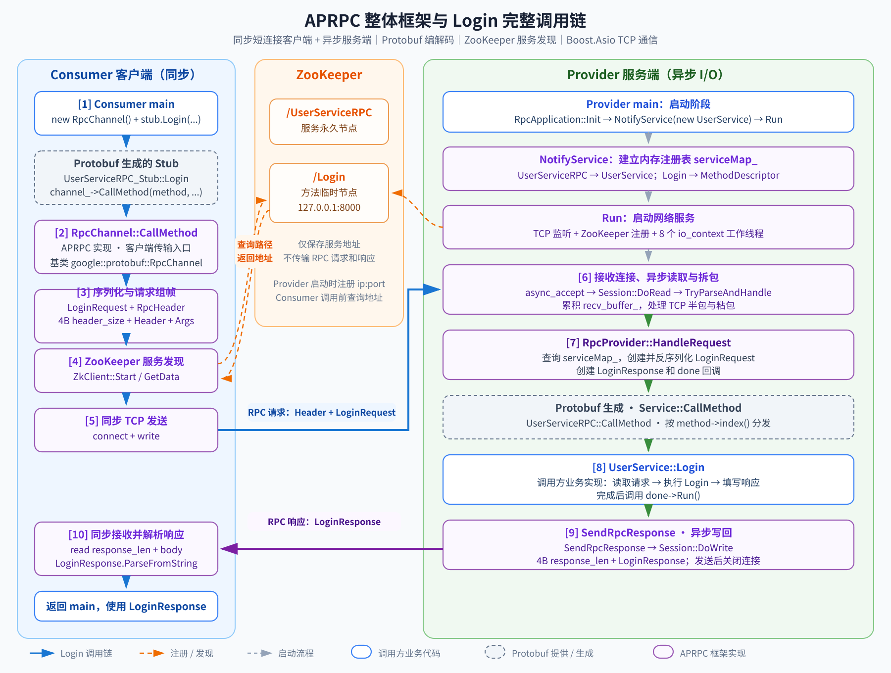

# RPC 框架学习笔记

这是一个基于 C++ 开发的高性能 RPC (Remote Procedure Call) 框架，使用了 Google Protobuf 进行数据序列化，并利用 Boost.Asio 进行网络通信。

## 1. 项目结构

```text
├── bin/                # 可执行文件及配置文件目录
│   ├── config.yaml     # 框架配置文件
│   ├── consumer        # 客户端示例程序
│   └── provider        # 服务端示例程序
├── build/              # 构建目录
├── config/             # 配置文件源码
├── example/            # 示例代码
│   ├── callee/         # 服务提供者 (Callee) 代码
│   ├── caller/         # 服务调用者 (Caller) 代码
│   └── proto_gen/      # Protobuf 生成的 C++ 文件
├── lib/                # 库文件输出目录
└── src/                # 框架核心源码
    ├── include/        # 头文件
    │   ├── rpcapplication.h # 框架初始化与配置管理
    │   ├── rpcprovider.h    # 服务端网络对象
    │   ├── rpcchannel.h     # 客户端通道
    │   ├── rpccontroller.h  # RPC 控制器
    │   └── rpcconfig.h      # 配置加载器
    ├── rpcheader/      # RPC 协议头定义 (Protobuf)
    ├── rpcapplication.cpp
    ├── rpcprovider.cpp
    ├── rpcchannel.cpp
    ├── rpccontroller.cpp
    └── ...
```

## 2. 核心组件

### 2.1 RpcApplication
- **作用**: 框架的基础类，负责框架的初始化和配置加载。
- **实现**: 单例模式。在程序启动时调用 `Init` 加载配置文件（如 `config.yaml`），提供全局的配置访问接口。

### 2.2 RpcProvider (服务端)
- **作用**: 负责发布 RPC 服务，启动网络服务器，处理远程调用请求。
- **实现**:
    - 使用 **Boost.Asio** 实现高性能的网络通信。
    - 维护一个 `serviceMap_`，存储注册的服务对象及其方法描述符 (`MethodDescriptor`)。
    - 采用 **Proactor 模型**（通过 `io_context`）配合线程池（8 个 I/O 工作线程）处理并发请求。
    - **NotifyService**: 将用户实现的服务对象注册到框架中。
    - **Run**: 启动 TCP 服务器，监听端口，接受连接并分发请求。

### 2.3 RpcChannel (客户端)
- **作用**: 继承自 `google::protobuf::RpcChannel`，负责数据的序列化、网络发送和响应接收。
- **实现**:
    - 重写了 `CallMethod` 方法。
    - 当客户端调用 Stub 对象的方法时，最终会调用 `CallMethod`。
    - 负责按照自定义协议组装数据，建立连接，发送请求，并等待响应。

### 2.4 RpcHeader
- **作用**: 定义 RPC 调用的元数据。
- **定义**: 使用 Protobuf 定义 (`src/rpcheader/rpcheader.proto`)。
    ```protobuf
    message RpcHeader {
        bytes service_name = 1;
        bytes method_name = 2;
        uint32 args_size = 3;
    }
    ```

## 3. 通信协议设计

为了解决 TCP 粘包/拆包问题，框架设计了自定义的应用层协议。

**数据包格式**:
```text
+----------------+-------------------------+-----------------------+
|  header_size   |       header_str        |       args_str        |
+----------------+-------------------------+-----------------------+
|    4 字节      |   (Protobuf 序列化)     |   (Protobuf 序列化)   |
| (网络字节序)   | service_name, method... |      请求参数数据     |
+----------------+-------------------------+-----------------------+
```

1. **header_size**: 4 字节整数，记录 `header_str` 的长度。
2. **header_str**: 包含服务名、方法名和参数长度的序列化数据。
3. **args_str**: 具体的请求参数序列化数据。

**服务端处理流程**:
1. 读取前 4 个字节，获取 `header_size`。
2. 读取 `header_size` 长度的数据，反序列化为 `RpcHeader` 对象，获取 `service_name` 和 `method_name`。
3. 根据 `RpcHeader` 中的 `args_size`，读取请求参数数据。
4. 根据 `service_name` 和 `method_name` 在 `serviceMap_` 中找到对应的服务和方法。
5. 反序列化参数，调用本地服务方法。
6. 将执行结果序列化，并加上长度前缀发送回客户端。

## 4. 整体框架与完整调用链

当前实现是 **同步短连接客户端 + 异步服务端**：客户端通过阻塞式 `connect/write/read` 等待结果；服务端通过 `async_accept/async_read_some/async_write` 处理网络 I/O。正常路径下，每次 RPC 都会重新进行 ZooKeeper 服务发现并新建 TCP 连接。

### 4.1 框架图

实线表示一次 `Login` 调用链，橙色和灰色虚线分别表示服务注册/发现与 Provider 启动流程。框样式区分代码归属：**蓝色**为调用方业务代码，**灰色虚线框**为 Protobuf 提供或生成的代码，**紫色**为 APRPC 框架实现。



### 4.2 一次 Login 请求的数据流

1. **Provider 启动并发布服务**  
   `example/callee/userservice.cpp` 的 `main` 依次执行 `RpcApplication::Init`、`NotifyService(new UserService())` 和 `Run`。`NotifyService` 建立服务/方法注册表；`Run` 监听 TCP，并在 ZooKeeper 创建 `/UserServiceRPC/Login` 等节点，节点数据为 Provider 的 `ip:port`。

2. **Consumer 发起类似本地方法的调用**  
   `example/caller/calluserservice.cpp` 创建 `UserServiceRPC_Stub`、`LoginRequest` 和 `LoginResponse`，然后调用 `stub.Login(...)`。

3. **Stub 进入统一 RPC 通道**  
   生成的 `UserServiceRPC_Stub::Login` 调用 `RpcChannel::CallMethod`，并传入 `Login` 的 `MethodDescriptor`、请求和响应对象。业务调用由此转换为框架的通用调用。

4. **客户端序列化并组帧**  
   `RpcChannel::CallMethod` 从描述符取得 `service_name="UserServiceRPC"` 和 `method_name="Login"`，将 `LoginRequest` 序列化为 `args_str`，再构造包含服务名、方法名和 `args_size` 的 `RpcHeader`，最终生成第 3 节描述的请求帧。

5. **服务发现与 TCP 发送**  
   客户端连接 ZooKeeper，查询 `/UserServiceRPC/Login`，得到 `ip:port`；随后同步执行 `connect` 和 `write`，将完整请求发送给 Provider。

6. **服务端接收并拆包**  
   `async_accept` 为连接创建 `Session`，`Session::DoRead` 将数据追加到持久接收缓冲区，`TryParseAndHandle` 按 `header_size` 和 `args_size` 判断帧是否完整，同时处理 TCP 半包和粘包。

7. **服务端分发到业务方法**  
   `RpcProvider::HandleRequest` 根据服务名和方法名查询 `serviceMap_`，通过 Protobuf 原型创建具体的 `LoginRequest`/`LoginResponse`，反序列化参数后调用 `service->CallMethod`。生成的 `UserServiceRPC::CallMethod` 再根据 `method->index()` 分发到 `UserService::Login`。

8. **业务完成并触发响应**  
   `UserService::Login` 读取请求、执行本地业务、填写响应，最后调用 `done->Run()`。该回调实际进入 `RpcProvider::SendRpcResponse`，将响应组织为 `[4B response_len][LoginResponse]`，再通过 `Session::DoWrite` 异步写回。

9. **客户端同步返回**  
   `RpcChannel::CallMethod` 阻塞读取响应长度和完整响应体，将数据反序列化到调用方提供的 `LoginResponse`，随后返回到 Consumer 的 `main`。

### 4.3 关键程序入口速查

| 阶段 | 程序入口 | 位置 |
|---|---|---|
| 服务接口定义 | `UserServiceRPC`、`LoginRequest`、`LoginResponse` | `example/proto_gen/user.proto` |
| Consumer 入口 | `main`、`stub.Login` | `example/caller/calluserservice.cpp` |
| 客户端统一入口 | `RpcChannel::CallMethod` | `src/rpcchannel.cpp` |
| 服务发现 | `ZkClient::Start`、`ZkClient::GetData` | `src/zookeeperutil.cpp` |
| Provider 入口 | `main`、`NotifyService`、`Run` | `example/callee/userservice.cpp` |
| 接收与拆包 | `Session::DoRead`、`TryParseAndHandle` | `src/rpcprovider.cpp` |
| 服务端统一分发 | `RpcProvider::HandleRequest` | `src/rpcprovider.cpp` |
| 业务实现 | `UserService::Login`、`done->Run` | `example/callee/userservice.cpp` |
| 响应发送 | `SendRpcResponse`、`Session::DoWrite` | `src/rpcprovider.cpp` |

### 4.4 服务开发步骤

1. **定义服务**：使用 `.proto` 文件定义服务接口和消息类型，并设置 `option cc_generic_services = true`，确保生成 Service 和 Stub。
2. **生成代码**：使用 `protoc` 生成 C++ 代码（`.pb.cc`、`.pb.h`）；仓库中已有 proto 的生成文件已纳入版本管理。
3. **服务端开发**：继承生成的 Service 类并实现业务虚函数，然后通过 `RpcProvider::NotifyService` 发布服务，调用 `Run` 启动。
4. **客户端开发**：创建 `RpcChannel` 和生成的 Stub，将 Channel 传给 Stub，然后直接调用 Stub 方法并读取响应。

## 5. 关键技术点

- **Protobuf**: 用于高效的数据序列化和反序列化，以及服务接口定义。
- **Boost.Asio**: 用于实现异步、非阻塞的网络 I/O，支持高并发。
- **多线程**: 服务端使用线程池处理 I/O 事件，提高吞吐量。
- **自定义协议**: 解决 TCP 传输中的边界问题。

## 6. 改进归档

- 长连接升级方案归档: [docs/long-connection-upgrade.md](docs/long-connection-upgrade.md)
- 客户端异步回调改造归档: [docs/client-async-callback-upgrade.md](docs/client-async-callback-upgrade.md)

## 7. 日志性能测试

已新增日志压测程序 `logger_perf`，用于评估不同并发线程下日志系统是否出现瓶颈。
当前日志系统支持两种落盘后端：

- `mmap`：基于内存映射的追加写
- `sequential`：类似 muduo `AppendFile` 的普通顺序追加写

框架配置中可选：

```yaml
logger:
  write_mode: "sequential"   # mmap | sequential
```

构建后可执行：

```bash
./bin/logger_perf [threads] [duration_seconds] [message_size] [writer_mode]
```

参数说明：
- `threads`: 生产日志的线程数，默认 `8`
- `duration_seconds`: 压测持续时间（秒），默认 `10`
- `message_size`: 每条日志消息字节数，默认 `128`
- `writer_mode`: 日志落盘后端，支持 `mmap` / `sequential`，默认 `sequential`

示例：

```bash
./bin/logger_perf 8 10 128 mmap
./bin/logger_perf 8 10 128 sequential
./bin/logger_perf 16 10 128 sequential
```

输出指标：
- `logs_per_s`: 每秒日志调用次数（生产速率）
- `avg_log_call_us`: 单次 `Logger::Log` 平均调用耗时
- `max_log_call_us`: 单次 `Logger::Log` 最大调用耗时

当线程数升高后 `logs_per_s` 不再增长，且 `avg_log_call_us` 持续上升时，可判定出现明显锁竞争/日志瓶颈。
